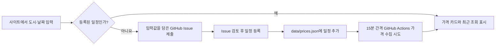

# 구현 계획

페이지는 정적 JSON에서 일치하는 일정을 찾습니다. 새 일정은 GitHub Issue로 제출할 수 있지만 자동 등록 경로는 아직 없습니다. 등록된 일정은 GitHub Actions가 네이버 항공권·트립닷컴·Google 항공편·스카이스캐너·익스피디아에서 가격 확인을 시도합니다. 같은 왕복 여정의 가격을 검증한 경우에만 금액을 새로 기록합니다.

게시 데이터 새로고침 버튼은 캐시를 사용하지 않고 JSON을 다시 읽습니다. 사용자가 선택한 여정 필터는 유지합니다. 실제 항공권 가격 확인은 15분 간격으로 예약된 GitHub Actions에서 시도합니다. 예약 실행은 지연되거나 생략될 수 있습니다.

각 사이트의 확인된 가격은 `history`에 시각과 함께 누적합니다. 화면은 이 점들을 시간순으로 연결해 가격 추이를 그립니다. 첫 기록은 점 하나만 보여주고, 확인에 실패한 실행은 새 가격 기록으로 추가하지 않습니다. `status=checked`인 현재 가격은 마지막 이력 값과 같아야 합니다.

## 검증

`npm run check`로 모든 일정의 날짜·출처 링크·가격 상태를 검사합니다. 공개 페이지에서 기존 일정 조회와 새 일정 요청 링크를 확인합니다. 예약 작업은 실제 실행 뒤 Issue 처리와 JSON 게시 결과를 확인합니다.

Skyscanner 제휴 API가 설정되면 두 구간의 출발 도시·도착 도시·날짜가 일치하는 예약 가능한 옵션에서 KRW 왕복 총액을 선택합니다. API가 설정되지 않았거나 정확한 결과가 없으면 기존 이력을 유지합니다. 테스트는 편도, 날짜 불일치, 목적지 불일치, 가격 단위 불명, 예약 링크 누락을 거부하는지 확인합니다. API 키는 GitHub Actions secret에서만 읽습니다.

Google 항공편은 화면에서 도시와 날짜를 선택해 생성한 검색 URL을 사용합니다. 자연어 `q` 검색에서는 같은 여정이 오류를 반환한 반면, 화면에서 생성된 `tfs` 검색은 결과를 반환했습니다. GitHub 실행에서도 화면 위치를 대한민국으로 맞추기 위해 `gl=KR`을 지정합니다. 위치가 대한민국이어도 검색 오류가 발생한 실행이 있으므로 위치만으로 오류 원인을 확정하지 않습니다. `tfs` 값 자체는 가격 검증 근거로 사용하지 않습니다. 화면에서 선택된 왕복·성인 1명·일반석·출발지·도착지·날짜·통화를 확인한 뒤 검색 결과의 접근성 이름에 표시된 `왕복 총 가격`만 새 가격 후보로 사용합니다. 오류·로딩 화면, 편도 금액, 다른 날짜의 값은 기록하지 않습니다.

Google 검색 결과가 자체 오류 화면을 보이면 화면의 새로고침을 최대 2회 눌러 다시 확인합니다. 계속 오류가 나면 일반 페이지 새로고침을 한 번 더 시도합니다. 그래도 오류가 나면 이번 시도는 실패로 기록하고 마지막 검증 가격과 이력을 보존합니다. 로봇 확인이나 접근 차단 화면은 재시도하지 않습니다.

Actions가 동시에 시작되어도 저장 직전에 최신 `main` 데이터를 읽고 시각별 가격 이력을 합칩니다. 더 최근 수집의 상태와 마지막 시도 시각을 사용한 뒤 push 충돌이 생기면 최신 데이터로 다시 합쳐 최대 3회 시도합니다.

네이버는 검색 URL을 연 뒤 화면의 검색 버튼을 눌러 결과를 요청합니다. 일반 결제수단의 왕복 카드를 선택하고, 상세 화면의 실제 출국·귀국편과 판매사 가격을 검증합니다. Actions 환경에서 네이버 검색 API 요청이 실패하면 `fare-api-unavailable` 상태를 남기고 이전 검증 가격을 유지합니다. 카드 할인·광고·`~부터` 금액은 가격 이력으로 저장하지 않습니다.

스카이스캐너 공개 검색 화면에 왕복 결과가 보이면 도시·날짜·인원·일반석·KRW와 두 항공편을 확인한 후 세금·수수료 포함 총액만 사용합니다. 로봇 확인 화면이 나타난 실행은 저장하지 않습니다. 제휴 승인 전 공식 API는 호출하지 않습니다.

PC 실행은 `scripts/run-local-collection.sh`로 별도 임시 checkout을 만들고 화면 Chromium에서 검색합니다. 검증된 결과와 실패 상태를 최신 `main` 데이터에 합쳐 push합니다. GitHub Pages는 이 JSON을 배포하므로 PC와 모바일이 같은 가격을 확인합니다. PC가 꺼져 있거나 잠자기 상태면 수집은 실행되지 않으며, Pages의 게시 데이터 새로고침은 새 검색을 시작하지 않습니다. 실행 계정은 쓰기 권한이 있는 GitHub 계정을 `FLIGHT_GH_ACCOUNT`로 지정합니다. 비밀번호·토큰은 저장소에 기록하지 않습니다.
