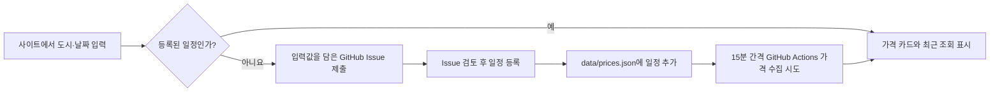

# 구현 계획

페이지는 정적 JSON에서 일치하는 일정을 찾습니다. 새 일정은 GitHub Issue로 제출할 수 있지만 자동 등록 경로는 아직 없습니다. 등록된 일정은 GitHub Actions가 네이버 항공권·트립닷컴·Google 항공편·스카이스캐너·익스피디아에서 가격 확인을 시도합니다. 같은 왕복 여정의 가격을 검증한 경우에만 금액을 새로 기록합니다.

게시 데이터 새로고침 버튼은 캐시를 사용하지 않고 JSON을 다시 읽습니다. 사용자가 선택한 여정 필터는 유지합니다. 실제 항공권 가격 확인은 15분 간격으로 예약된 GitHub Actions에서 시도합니다. 예약 실행은 지연되거나 생략될 수 있습니다.

각 사이트의 확인된 가격은 `history`에 시각과 함께 누적합니다. 화면은 이 점들을 시간순으로 연결해 가격 추이를 그립니다. 첫 기록은 점 하나만 보여주고, 확인에 실패한 실행은 새 가격 기록으로 추가하지 않습니다. `status=checked`인 현재 가격은 마지막 이력 값과 같아야 합니다.

## 검증

`npm run check`로 모든 일정의 날짜·출처 링크·가격 상태를 검사합니다. 공개 페이지에서 기존 일정 조회와 새 일정 요청 링크를 확인합니다. 예약 작업은 실제 실행 뒤 Issue 처리와 JSON 게시 결과를 확인합니다.

Skyscanner 제휴 API가 설정되면 두 구간의 출발 도시·도착 도시·날짜가 일치하는 예약 가능한 옵션에서 KRW 왕복 총액을 선택합니다. API가 설정되지 않았거나 정확한 결과가 없으면 기존 이력을 유지합니다. 테스트는 편도, 날짜 불일치, 목적지 불일치, 가격 단위 불명, 예약 링크 누락을 거부하는지 확인합니다. API 키는 GitHub Actions secret에서만 읽습니다.

Google 항공편 화면에서는 선택된 왕복·성인 1명·일반석·출발지·도착지·날짜·통화를 확인합니다. 그 뒤 검색 결과의 접근성 이름에 표시된 `왕복 총 가격`만 새 가격 후보로 사용합니다. 오류·로딩 화면, 편도 금액, 다른 날짜의 값은 기록하지 않습니다.
