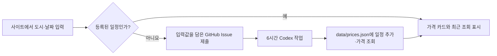

# 구현 계획

페이지는 정적 JSON에서 일치하는 일정을 찾습니다. 새 일정은 GitHub Issue로 제출된 뒤 Codex 작업이 네이버 항공권·트립닷컴·Google 항공편·스카이스캐너의 도시 코드와 검색 URL을 확인해 등록합니다. 출처 화면에서 같은 왕복 여정의 가격을 확인한 경우에만 금액을 기록합니다. 확인할 수 없으면 가격 확인 대기로 표시합니다.

게시 데이터 새로고침 버튼은 캐시를 사용하지 않고 JSON을 다시 읽습니다. 사용자가 선택한 여정 필터는 유지합니다. 실제 항공권 가격 확인은 6시간 작업에서 수행합니다.

## 검증

`npm run check`로 모든 일정의 날짜·출처 링크·가격 상태를 검사합니다. 공개 페이지에서 기존 일정 조회와 새 일정 요청 링크를 확인합니다. 예약 작업은 실제 실행 뒤 Issue 처리와 JSON 게시 결과를 확인합니다.
